# 🤖 Awesome Multi-Agent Collaboration & AI Brainstorming 🧠

<p align="center">
  
</p>

<p align="center">
  <a href="https://github.com/ishandutta2007/Awesome-Awesome-Awesome"></a>
  <a href="https://discord.gg/jc4xtF58Ve"></a>
  <a href="https://github.com/ishandutta2007/Awesome-Multi-Agent-Collaboration-AI-Brainstorming/stargazers"></a>
  <a href="https://github.com/ishandutta2007/Awesome-Multi-Agent-Collaboration-AI-Brainstorming/network/members"></a>
  <a href="https://github.com/ishandutta2007/Awesome-Multi-Agent-Collaboration-AI-Brainstorming/blob/main/LICENSE"></a>
  <a href="https://github.com/ishandutta2007"></a>
</p>

---

## 🌟 Overview & SEO Meta Description

**Awesome Multi-Agent Collaboration & AI Brainstorming** is the ultimate curated directory of top-tier **SaaS platforms**, **developer frameworks**, and **open-source GitHub repositories** powering the next generation of collective AI intelligence. 

Explore cutting-edge solutions for **collaborative AI brainstorming rooms**, **Multi-LLM Council debates**, **Mixture-of-Agents (MoA)** consensus engines, **hierarchical agent workflows**, **visual ideation whiteboards**, and **autonomous agent group chats**. Whether you are architecting a multi-agent debate system with LangGraph and AutoGen, orchestrating enterprise crews with CrewAI, or running local brainstorming swarms with Ollama, this ecosystem guide provides actionable data, exact SaaS pricing tiers, free plan limits, enterprise valuations, and GitHub star trajectories.

---

## 📊 Sector Overview & Market Dynamics

The global market for **Multi-Agent Systems (MAS)** and autonomous AI agent platforms is estimated at approximately **$4.2 billion to $10.9 billion in 2026**, expanding at an extraordinary compound annual growth rate (**CAGR of 45%–49%**) as enterprises evolve beyond single-turn prompt interactions toward multi-agent collaborative execution. 

The industry exhibits a dual dynamic: while foundational cloud compute and underlying foundation models remain heavily concentrated among a handful of tech giants, the **application, orchestration, and brainstorming framework layer is moderately to highly fragmented**, characterized by fierce competition between specialized SaaS platforms and hyper-fast open-source community frameworks where no single player commands dominant market share.

---

## 📑 Table of Contents

- [📊 Sector Overview & Market Dynamics](#-sector-overview--market-dynamics)
- [💼 SaaS & Hosted Multi-Agent Platforms](#-saas--hosted-multi-agent-platforms)
- [🐙 Open-Source GitHub Projects & Frameworks](#-open-source-github-projects--frameworks)
- [🛠️ Architecture Topologies for Collaborative Brainstorming](#️-architecture-topologies-for-collaborative-brainstorming)
- [🤝 How to Contribute](#-how-to-contribute)
- [💖 Support & Sponsorship](#-support--sponsorship)
- [📈 Star History](#-star-history)
- [⚠️ Disclaimer](#️-disclaimer)

---

## 💼 SaaS & Hosted Multi-Agent Platforms

The table below lists leading managed SaaS platforms and visual cloud environments for multi-agent brainstorming and collaborative orchestration, sorted in descending order by **Company Size / Valuation / Estimated Revenue**.

| SaaS Platform 🚀 | Sector Role & Brainstorming Capability 💡 | Company Size / Valuation / Revenue 🏢 | Pricing (Starting Paid Tier) 💳 | Free Tier / Free Trial Limits 🎁 |
| :--- | :--- | :--- | :--- | :--- |
| **[Miro AI](https://miro.com)** | Visual infinite whiteboard with AI clustering, automated mind mapping, and team brainstorming synthesis | Acquired by Bending Spoons at **$1.355B Enterprise Value** ($1.79B equity value; ~$600M ARR; peak $17.5B) | **$8/member/month** (Starter billed annually) or $10/member/month billed monthly | **Free Forever Plan**: 3 editable boards, unlimited team members, view-only on older boards, basic Miro AI credits cap |
| **[LangGraph Platform](https://langchain.com)** | Managed deployment engine for cyclic multi-actor graph workflows, human-in-the-loop checkpoints, and agent councils | **$3.0 Billion Valuation** ($300M Series C led by CapitalG; ~$16M ARR) | **$39/seat/month** (LangSmith Plus tier + $0.001/node execution for LangGraph cloud deployments) | **Free Forever Plan**: Up to 5,000 trace executions/month on developer tier, 1 developer seat |
| **[Poe by Quora](https://poe.com)** | Multi-LLM chat aggregator summoning diverse models (`@Claude`, `@GPT-4o`, `@Gemini`, `@Llama`) in one brainstorming thread | **$500 Million Valuation** ($75M funding round led by a16z; parent Quora) | **$4.99/month** (Entry tier) or **$19.99/month** (Standard annual plan) | **Free Forever Plan**: Daily replenished compute points (up to ~3,000 points/day for standard LLM queries) |
| **[Dify Cloud](https://dify.ai)** | Visual LLMOps & agentic workflow studio supporting multi-agent collaboration, RAG knowledge bases, and synthesis pipelines | **$180 Million Valuation** ($30M Series Pre-A led by HSG; ~$3.1M ARR) | **$59/workspace/month** (Professional tier with 5,000 credits/mo and 3 members) | **Free Forever Sandbox Plan**: 200 message credits (one-time trial), 5 apps, 1 member, 50 knowledge documents (50 MB) |
| **[CrewAI Enterprise](https://crewai.com)** | Managed Agent Management Platform (AMP) for multi-agent squads with automated role delegation and guardrail monitoring | **$177 Million Valuation** ($18M total raised; Series A led by Insight Partners; ~$3.2M ARR) | **Custom Enterprise Pricing** (scales based on enterprise workflow run volume; contact sales) | **Free Forever Plan**: 50 workflow executions/month, visual studio editor, AI copilot, GitHub integration |
| **[Botpress](https://botpress.com)** | Conversational multi-agent workspace with agent handoffs, shared variables, autonomous autonomous problem-solving | **$120 Million Valuation** ($45M total funding; Series B led by Framework Venture Partners; ~$10M ARR) | **$89/month** (Plus Plan for small teams) or $495/month (Team Plan with unlimited seats) | **Free Forever Plan**: 2,000 monthly incoming messages, 1 bot, standard community support |
| **[Stack AI](https://stack-ai.com)** | Enterprise no-code AI orchestration canvas for chaining multi-LLM debate nodes, red-teaming, and parallel critique | **$75 Million Acquisition** (Acquired by Asana; previously raised $20M; ~$3M ARR) | **Custom Enterprise Pricing** (formerly entry tiers started at $199/month; now customized per deployment) | **Free Forever Plan**: 500 workflow runs/month, 2 active projects, 1 user seat |
| **[Letta Cloud](https://letta.com)** | Managed cloud runtime for stateful LLM agents with persistent, self-updating memory blocks across collaborative sessions | **$70 Million Valuation** ($10M Seed led by Felicis Ventures; spun out from UC Berkeley MemGPT) | **$20/month** (Pro Plan with 20 stateful agents and $20 monthly usage credits) | **Free Forever Plan**: Up to 3 stateful agents, 5 MiB memory repository storage, BYO API keys |
| **[Flowise Cloud](https://flowiseai.com)** | Hosted drag-and-drop canvas for multi-agent supervisors, sequential critique chains, and conversational worker teams | **Acquired by Workday** (YC W23 graduate; ~$1M ARR run-rate prior to acquisition) | **$35/month** (Starter Plan with 10,000 predictions/month and unlimited flows) | **Free Forever Plan**: 2 active flows, 100 monthly predictions, 5 MB asset storage |
| **[Fixie.ai](https://fixie.ai)** | Real-time speech and multi-agent interaction platform powering collaborative voice companions and Ultravox AI | **$17 Million Seed Stage** (Raised $17M Seed led by Redpoint Ventures; ~$500K ARR) | **Usage-Based Tier Starting at $0.005/min** for real-time speech/agent API consumption | **Free Trial**: $10 complimentary API credits for developer exploration and audio streaming |

---

## 🐙 Open-Source GitHub Projects & Frameworks

The table below catalogs premier open-source multi-agent collaboration frameworks, brainstorming councils, visual whiteboards, and LLM orchestration engines. Sorted in descending order by **GitHub_Stars** ⭐.

| Repository & Framework 🛠️ | GitHub Stars_Count 🌟 | Primary Category 🏷️ | Key Features & Brainstorming Capabilities 💡 |
| :--- | :---: | :--- | :--- |
| **[ollama/ollama](https://github.com/ollama/ollama)** | [](https://github.com/ollama/ollama/stargazers) | Local Model Runtime | Run open-weights frontier LLMs (Llama, DeepSeek, Qwen, Mistral) locally to power multi-agent councils offline without cloud API costs. |
| **[langgenius/dify](https://github.com/langgenius/dify)** | [](https://github.com/langgenius/dify/stargazers) | Visual Workflow Studio | Production-grade open-source LLMOps platform featuring visual agent orchestration, shared RAG pipelines, and multi-model collaboration. |
| **[open-webui/open-webui](https://github.com/open-webui/open-webui)** | [](https://github.com/open-webui/open-webui/stargazers) | Multi-Model Web UI | Feature-rich ChatGPT-like UI with side-by-side multi-model arena comparisons, `@model` inline switching, and multi-agent group chats. |
| **[langflow-ai/langflow](https://github.com/langflow-ai/langflow)** | [](https://github.com/langflow-ai/langflow/stargazers) | Visual Agent Canvas | Dynamic node-based canvas for assembling multi-agent brainstorming flows, prompt engineering experiments, and vector store retrieval. |
| **[langchain-ai/langchain](https://github.com/langchain-ai/langchain)** | [](https://github.com/langchain-ai/langchain/stargazers) | Orchestration Framework | Foundational Python/TypeScript library for composing LLM chains, agent tool calling, and multi-model collaborative architectures. |
| **[excalidraw/excalidraw](https://github.com/excalidraw/excalidraw)** | [](https://github.com/excalidraw/excalidraw/stargazers) | Collaborative Whiteboard | Virtual collaborative hand-drawn canvas integrating AI diagram generation and text-to-mindmap brainstorming workflows. |
| **[toeverything/AFFiNE](https://github.com/toeverything/AFFiNE)** | [](https://github.com/toeverything/AFFiNE/stargazers) | Workspace & Canvas | All-in-one open-source workspace merging docs, whiteboards, and multi-agent AI copilot brainstorming for creative synthesis. |
| **[FoundationAgents/MetaGPT](https://github.com/FoundationAgents/MetaGPT)** | [](https://github.com/FoundationAgents/MetaGPT/stargazers) | Multi-Role Software Firm | Multi-agent framework assigning specialized SOPs (Product Manager, Architect, Engineer, QA) for structured ideation and code delivery. |
| **[BerriAI/litellm](https://github.com/BerriAI/litellm)** | [](https://github.com/BerriAI/litellm/stargazers) | LLM Gateway & Proxy | Unified OpenAI-compatible interface to call 100+ LLMs simultaneously; essential for multi-agent council load-balancing and fallbacks. |
| **[microsoft/autogen](https://github.com/microsoft/autogen)** | [](https://github.com/microsoft/autogen/stargazers) | Multi-Agent Framework | Microsoft's premier framework for customizable agent group chats, autonomous debate routing, and AutoGen Studio visual prototyping. |
| **[crewAIInc/crewAI](https://github.com/crewAIInc/crewAI)** | [](https://github.com/crewAIInc/crewAI/stargazers) | Autonomous Squads | Production-ready multi-agent framework where role-playing agents (Researcher, Critic, Writer) autonomously collaborate and delegate. |
| **[FlowiseAI/Flowise](https://github.com/FlowiseAI/Flowise)** | [](https://github.com/FlowiseAI/Flowise/stargazers) | Low-Code UI | Open-source drag-and-drop tool to construct LangChain and multi-agent supervisor hierarchies with instant conversational endpoints. |
| **[LibreChat-AI/LibreChat](https://github.com/LibreChat-AI/LibreChat)** | [](https://github.com/LibreChat-AI/LibreChat/stargazers) | AI Chat Platform | Omnichannel AI chat platform supporting multi-agent custom presets, multimodal brainstorming, and side-by-side LLM outputs. |
| **[langchain-ai/langgraph](https://github.com/langchain-ai/langgraph)** | [](https://github.com/langchain-ai/langgraph/stargazers) | Cyclic Multi-Agent Graph | Cyclical graph library engineered for resilient multi-agent collaboration, state machine routing, human-in-the-loop, and debate loops. |
| **[langfuse/langfuse](https://github.com/langfuse/langfuse)** | [](https://github.com/langfuse/langfuse/stargazers) | Observability & Tracing | Open-source LLM engineering platform to trace multi-agent token consumption, debug inter-agent communications, and evaluate outputs. |
| **[OpenBMB/ChatDev](https://github.com/OpenBMB/ChatDev)** | [](https://github.com/OpenBMB/ChatDev/stargazers) | Virtual Software Studio | Communicative agent framework organizing virtual employees through multi-turn conversational brainstorming and peer code reviews. |
| **[stanford-oval/storm](https://github.com/stanford-oval/storm)** | [](https://github.com/stanford-oval/storm/stargazers) | Knowledge Curation | Stanford's multi-perspective system simulating expert brainstorming dialogues to conduct grounded web research and synthesize reports. |
| **[assafelovic/gpt-researcher](https://github.com/assafelovic/gpt-researcher)** | [](https://github.com/assafelovic/gpt-researcher/stargazers) | Autonomous Research | Autonomous multi-agent research assistant that scrapes, aggregates, filters, and synthesizes 20+ web sources into in-depth research briefs. |
| **[letta-ai/letta](https://github.com/letta-ai/letta)** | [](https://github.com/letta-ai/letta/stargazers) | Stateful Memory Engine | Memory management framework (formerly MemGPT) giving brainstorming agents infinite virtual context and self-editing long-term recall. |
| **[camel-ai/camel](https://github.com/camel-ai/camel)** | [](https://github.com/camel-ai/camel/stargazers) | Communicative Agents | Pioneer in communicative multi-agent role-playing, inception prompting, and autonomous cooperative task exploration. |
| **[TransformerOptimus/SuperAGI](https://github.com/TransformerOptimus/SuperAGI)** | [](https://github.com/TransformerOptimus/SuperAGI/stargazers) | Autonomous Agent OS | Infrastructure for managing concurrent agent executions, graphical console monitoring, shared vector memory, and marketplace tools. |
| **[e2b-dev/E2B](https://github.com/e2b-dev/E2B)** | [](https://github.com/e2b-dev/E2B/stargazers) | Secure Agent Sandboxes | Cloud sandboxes for AI agents; lets brainstorming agents execute code, analyze datasets, and verify ideas in isolated micro-VMs. |
| **[markmap/markmap](https://github.com/markmap/markmap)** | [](https://github.com/markmap/markmap/stargazers) | Markdown Mindmaps | Visual engine to transform multi-agent Markdown notes into interactive vector mind maps instantly. |
| **[kyegomez/swarms](https://github.com/kyegomez/swarms)** | [](https://github.com/kyegomez/swarms/stargazers) | Swarm Intelligence | Modular framework for building Mixture-of-Agents (MoA), Majority Voting, hierarchical swarms, and multi-agent roundtables. |
| **[ag2ai/ag2](https://github.com/ag2ai/ag2)** | [](https://github.com/ag2ai/ag2/stargazers) | Multi-Agent Evolution | The open-source evolution of AutoGen (formerly AutoGen 0.2/0.4), introducing resilient group chats, agent socket protocols, and tool use. |
| **[freeplane/freeplane](https://github.com/freeplane/freeplane)** | [](https://github.com/freeplane/freeplane/stargazers) | Mind Mapping Tool | Powerful open-source desktop application for knowledge structuring, hierarchical concept trees, and visual brainstorming ideation. |
| **[togethercomputer/MoA](https://github.com/togethercomputer/MoA)** | [](https://github.com/togethercomputer/MoA/stargazers) | Mixture-of-Agents | Reference implementation of layered Multi-LLM collaboration where proposer models generate candidates and aggregator models synthesize solutions. |
| **[google-deepmind/concordia](https://github.com/google-deepmind/concordia)** | [](https://github.com/google-deepmind/concordia/stargazers) | Social Simulation | Google DeepMind's library for simulating generative agent societies, Game-Master-moderated group discussions, and behavioral role-play. |
| **[Farama-Foundation/ChatArena](https://github.com/Farama-Foundation/ChatArena)** | [](https://github.com/Farama-Foundation/ChatArena/stargazers) | Multi-Agent Game Arena | Research environment designed to study communication games, peer debates, negotiation protocols, and competitive LLM social dynamics. |
| **[mindroom-ai/mindroom](https://github.com/mindroom-ai/mindroom)** | [](https://github.com/mindroom-ai/mindroom/stargazers) | Brainstorming Rooms | Dedicated multi-agent brainstorming rooms where customizable AI personas debate, critique hypotheses, and formulate consensus plans. |

---

## 🛠️ Architecture Topologies for Collaborative Brainstorming

When building multi-agent brainstorming systems, developers commonly employ one of four architectural topologies:

```
1. Roundtable / Council (Peer Debate)
   ┌─────────┐       ┌─────────┐
   │ Agent A ├───────┤ Agent B │
   └────┬────┘       └────┬────┘
        │   ┌─────────┐   │
        └───┤ Agent C ├───┘
            └─────────┘
   (All agents converse via a shared bus; ideal for creative ideation)

2. Supervisor / Hierarchical Delegation
          ┌──────────────┐
          │  Supervisor  │
          └──────┬───────┘
       ┌─────────┴─────────┐
   ┌───▼───┐           ┌───▼───┐
   │Critic │           │Writer │
   └───────┘           └───────┘
   (Orchestrator assigns sub-tasks and synthesizes deliverables)

3. Mixture-of-Agents (MoA Layering)
   Layer 1 (Proposers): [LLM 1]  [LLM 2]  [LLM 3]
                              │        │        │
   Layer 2 (Aggregator):      ▼        ▼        ▼
                        [Synthesizer / Arbiter]
   (Iterative refinement where aggregators synthesize peer outputs)

4. Critic-Refiner Loop (Adversarial Red-Teaming)
   [Generator Agent] ───► [Draft] ───► [Adversarial Critic]
          ▲                                    │
          └─────────── Revision Feedback ──────┘
```

---

## 🤝 How to Contribute

We welcome high-quality contributions from researchers, builders, and community enthusiasts!

1. **Fork the Repository** to your own GitHub account.
2. **Add or Update Entries** in `README.md` maintaining table formatting, explicit pricing tiers, free limits, company sizes, and valid GitHub links.
3. **Verify Links & Badges**: Ensure all repo URLs point to authentic sources and Stars_Badges utilize `https://img.shields.io/github/stars/<owner>/<repo>?style=social&color=white`.
4. **Submit a Pull Request** with a descriptive title and brief context explaining your changes.

For the parent collection of awesome lists, check out [Awesome Awesome Awesome](https://github.com/ishandutta2007/Awesome-Awesome-Awesome).

---

## 💖 Support & Sponsorship

If you find this ecosystem directory helpful for your research, startup ideation, or multi-agent AI architecture:

- ⭐ **Star this repository** to help others discover it.
- 🍴 **Fork the repo** to save your personal reference and build upon it.
- 📢 **Share it** on X/Twitter, LinkedIn, Discord, and Reddit.
- ☕ **Sponsor the Project**: If you would like to support ongoing curation and ecosystem maintenance, consider buying a coffee via our **[GitHub Sponsors Dashboard](https://github.com/sponsors/ishandutta2007)**. Every contribution is deeply appreciated!

---

## 📈 Star History

[](https://star-history.dera.page/#ishandutta2007/Awesome-Multi-Agent-Collaboration-AI-Brainstorming&type=date&legend=top-left)
[](https://www.star-history.com/#ishandutta2007/Awesome-Multi-Agent-Collaboration-AI-Brainstorming&type=date&legend=top-left)

---

## ⚠️ Disclaimer

- This repository is a community-curated educational and technical resource; inclusion does not constitute commercial endorsement.
- **Token Consumption Notice**: Multi-agent collaborative topologies, round-robin debates, and Mixture-of-Agents architectures scale token usage multiplicatively with the number of participating agents and conversation rounds. Always implement turn caps (`max_round`), timeout intervals, and budget boundaries.
- **Security & Memory Safety**: When connecting multiple autonomous agents to shared persistent memory stores (such as Letta or vector databases), sanitize all tool inputs to guard against prompt injection vulnerabilities and cross-agent hallucination loops.
